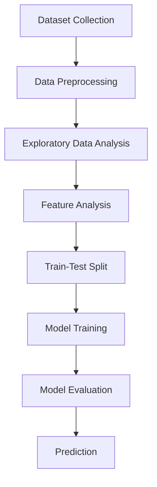

# ❤️ Heart Disease Prediction | Machine Learning

A Data-Driven Machine Learning Approach to Cardiovascular Risk Prediction

---

## Overview

**Heart Disease Prediction** is a Machine Learning project that analyzes patient health attributes to estimate the likelihood of heart disease. The project applies data preprocessing, exploratory data analysis, feature analysis, and supervised machine learning techniques to build and evaluate predictive models.

The objective is to explore how machine learning can identify patterns in healthcare data and support data-driven cardiovascular risk assessment.

## Key Features

- **Data Analysis:** Explore patient health data and identify meaningful patterns.
- **Data Preprocessing:** Handle data preparation and feature transformation.
- **Exploratory Data Analysis:** Visualize distributions, correlations, and relationships between features.
- **Machine Learning:** Train multiple classification algorithms.
- **Model Evaluation:** Evaluate models using standard classification metrics.
- **Prediction:** Predict the likelihood of heart disease based on input features.

## Tech Stack

| Technology | Purpose |
|---|---|
| Python | Core programming language |
| Pandas | Data manipulation and analysis |
| NumPy | Numerical computation |
| Matplotlib | Data visualization |
| Seaborn | Statistical visualization |
| Scikit-learn | Machine learning and evaluation |
| Jupyter Notebook | Development and experimentation |

## Machine Learning Models

The project can evaluate and compare the following classification algorithms:

- Logistic Regression
- K-Nearest Neighbors (KNN)
- Random Forest Classifier
- Support Vector Machine (SVM)

<text color="secondary" size="sm">The models listed above should be adjusted to match the algorithms actually implemented in the project.</text>

## Dataset Description

The dataset contains patient health-related attributes used for cardiovascular risk classification.

| Feature | Description |
|---|---|
| Age | Age of the patient |
| Sex | Encoded gender attribute |
| CP | Chest pain category |
| Trestbps | Resting blood pressure |
| Chol | Serum cholesterol level |
| Fbs | Fasting blood sugar |
| Restecg | Resting ECG results |
| Thalach | Maximum heart rate |
| Exang | Exercise-induced angina |
| Oldpeak | ST depression measurement |
| Slope | Slope of the ST segment |
| Ca | Major blood vessels attribute |
| Thal | Thal-related category |
| Target | Heart disease classification |

## Workflow



## Model Evaluation

The models are evaluated using standard classification metrics:

- **Accuracy** — Overall proportion of correct predictions.
- **Precision** — Proportion of positive predictions that are correct.
- **Recall** — Proportion of actual positive cases correctly identified.
- **F1-Score** — Balance between precision and recall.
- **Confusion Matrix** — Analysis of correct and incorrect classifications.

## Project Structure

```text
Heart-Disease-Prediction/
│
├── dataset/
│   └── heart.csv
│
├── notebook/
│   └── heart_disease_prediction.ipynb
│
├── README.md
├── requirements.txt
└── .gitignore
```

## Installation & Setup

### 1. Clone the Repository

```bash
git clone https://github.com/your-username/heart-disease-prediction.git
```

### 2. Navigate to the Project Directory

```bash
cd heart-disease-prediction
```

### 3. Install Dependencies

```bash
pip install -r requirements.txt
```

### 4. Launch Jupyter Notebook

```bash
jupyter notebook
```

Open the notebook and execute the cells to perform analysis, train models, and generate predictions.

## Requirements

```text
pandas
numpy
matplotlib
seaborn
scikit-learn
jupyter
```

## Future Scope

- Integrate a web-based prediction interface.
- Explore hyperparameter optimization.
- Evaluate additional classification algorithms.
- Incorporate larger and more diverse healthcare datasets.
- Develop an interactive dashboard for prediction and analysis.
- Explore explainable AI techniques to interpret model predictions.

## Disclaimer

This project is intended strictly for educational and research purposes. Machine learning predictions are not medical diagnoses. The model's output should not be used to make medical decisions without qualified healthcare professionals.

---
